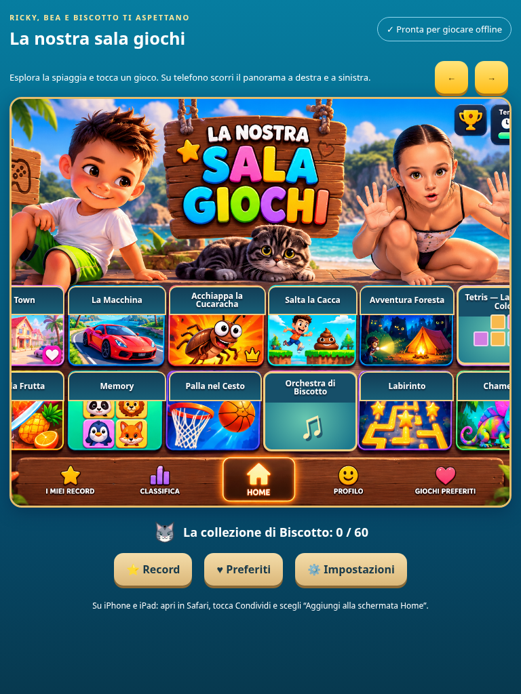

# V8 — verifiche e collaudo

## Base e integrità

Lavoro separato sul branch codex/v8-biscottini, derivato da origin/main commit 2a56633, che contiene la PR #1 già unita dal proprietario. Nessun merge è stato eseguito durante il lavoro V8.

La struttura precedente è stata verificata prima delle modifiche: home/card, moduli dei giochi, adattatore Andrea, archivio locale, manifest, generatore e service worker. Sono stati conservati navigazione, record, preferiti, installazione PWA e motore originale di Corsa su Strada.

home.png mantiene il blob Git 8d2f2a2e58f65fff47f4eee65ba16fc5763d3563. Il file non è stato rigenerato, ritagliato, sovrascritto o modificato; viene mostrato intero nel contenitore panoramico con scorrimento orizzontale su schermi piccoli. Le etichette HTML coprono i vecchi nomi delle tessere sostituite. I pulsanti generali restano esterni alla grafica.

Il corpo originale road.js di Andrea mantiene il blob Git 4b88da0d15b44b3d66fb4208ad5c22762a1df829. L'adattatore osserva i checkpoint senza modificare proiezione, salite, curve, traffico o fisica.

## Test automatici

Esito finale: **14 test di logica/integrità e 22 controlli browser superati**. Tutti i dodici giochi si riaprono offline; nessun errore JavaScript runtime rilevato.

Comandi ripetibili:

```sh
python3 scripts/build-offline.py
npm test
npm run test:browser
```

Node.js 24, Playwright 1.62.1 e Chromium headless. Il server del test usa il sottopercorso /sala-giochi-nipotini/. Tutti i binari originali, compresa home.png, sono inclusi: nessun segnaposto nel collaudo finale.

La suite di logica contiene 14 test:

- Hash degli originali e inventario offline ricorsivo con 32 risorse locali.
- 500 labirinti generati nelle cinque dimensioni, tutti con uscita e corridoi raggiungibili.
- Fisica del canestro, direzione di attraversamento del cerchio e lancio che può segnare.
- Archivio locale bloccato, record numerici massimi e tentativi minimi.
- Sette tetramini da quattro blocchi, 7-bag equo, collisioni con pareti/pavimento/stack, rotazioni, eliminazione righe, punteggio, tutti i dieci livelli, continuazione per il record e game over.
- Giudizi ritmici, finestre temporali, corsie sbagliate e note mancate; completamento dei cinque brani originali e soglia dell'80% senza inferire il risultato dal solo punteggio.
- Migrazione versione 8 senza cancellazione dei vecchi punteggi e archiviazione dei giochi ritirati.
- Soglie universali, dodici percorsi, completamento in ordine, massimo cinque Biscottini per gioco e sessanta totali, nessuna regressione dopo risultati peggiori.

La suite browser verifica:

- Apertura, riavvio e chiusura di tutti i dodici giochi a 390×844, 844×390, 768×1024, 1440×900 e 320×568.
- Home panoramica leggibile, aree touch HTML, nessun overflow orizzontale del documento e screenshot smartphone/tablet/desktop. Gli screenshot mostrano il panorama centrato; l'utente può scorrerlo interamente.
- Record migrati, assenza dei due giochi ritirati nei record e nella navigazione; Tab, Escape e focus del dialogo.
- Completamento dei cinque livelli Memory, delle cinque missioni Town, delle cinque zone Foresta compreso il ritorno finale, dei cinque labirinti e delle cinque sfide Chameleon.
- Esecuzione dei cinque brani Orchestra con tocchi temporizzati; modalità silenziosa, volume e medaglie persistenti.
- Tetris tramite controlli touch, pausa/ripresa, perdita del focus e top-out: il solo punteggio non assegna Biscottini. La progressione fino a 50 righe è verificata nel motore con scenari controllati di righe, non dichiarata come partita completa vinta manualmente nel browser.
- Canestro da swipe touch con fisica; prima missione Cucaracha conclusa con catture reali; primo percorso runner superato con input da tastiera e ostacoli reali; prima sfida frutta completata con swipe touch nativo emulato.
- Primo checkpoint fisico del gioco di Andrea e assegnazione del traguardo corrispondente. L'integrità del motore e i limiti di tutte le ricompense sono verificati separatamente.
- Persistenza di record, preferiti e medaglie dopo reload e aggiornamento della cache su richiesta; rimozione della vecchia cache.
- Riapertura di tutti i dodici giochi con rete disabilitata, richiesta di ogni risorsa precachata e riavvio del processo Chromium con profilo persistente e nuovi giochi disponibili offline.
- Una risorsa obbligatoria mancante impedisce l'attivazione del service worker e l'annuncio di disponibilità offline.
- Assenza di errori JavaScript runtime e di richieste a risorse esterne durante la suite.

Il runner ha ricevuto una correzione dell'area di collisione degli ostacoli grandi: la verifica di sopravvivenza ha mostrato che la vecchia area poteva eccedere il tempo utile di salto alle basse velocità. Il gatto SVG intero e il motore di salto sono conservati. Per la prova automatica di sopravvivenza il tempo è controllato e si usa la tastiera, evitando che la latenza dell'automazione touch determini l'esito.

I risultati dettagliati della suite browser vengono scritti in test-results/browser-v8.json; le immagini in test-results/ vengono copiate anche in docs/screenshots per la revisione della PR.

## Screenshot





## Collaudo da eseguire su hardware reale

Non sono state eseguite prove fisiche su iPhone, iPad o Android. Il touch nativo qui è emulato da Chromium. Per il revisore:

1. Servire il branch V8 da HTTPS in un ambiente di prova, senza sostituire main. Aprire da Safari su iPhone/iPad e Chrome su Android, attendere “Pronta per giocare offline”.
2. Installare in modalità standalone. Su Safari: Condividi → Aggiungi alla schermata Home. Su Android: Installa dal browser o dal pulsante, se disponibile.
3. Provare panorama, pulsanti di scorrimento, tutti i giochi, orientamenti, notch e safe area. Controllare che i comandi generali restino accessibili fuori dalla grafica.
4. In Orchestra avviare il brano con un gesto, controllare audio dopo sospensione/riapertura, volume e modalità silenziosa; provare la sincronizzazione sul dispositivo effettivo.
5. In Tetris provare pressione mantenuta, rotazione, discesa rapida, caduta immediata, pausa e cambio app. In Corsa su Strada verificare sterzo mantenuto, curve, salite, traffico e checkpoint casuali.
6. Conquistare una medaglia, riprovare con esito peggiore: punteggio massimo e medaglia non devono diminuire.
7. Attivare modalità aereo, chiudere completamente l'app e riaprirla dall'icona; provare tutti i dodici giochi e verificare record e collezione.
8. Distribuire una successiva versione nell'ambiente di prova: attendere l'avviso, accettare l'aggiornamento e ricontrollare offline e dati.

Il browser può cancellare i dati del sito se l'utente li elimina o se il sistema libera spazio. Se il salvataggio è bloccato, resta disponibile solo la sessione temporanea: questo limite è esplicitato nelle impostazioni.
